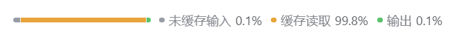

# dsh-token-bar

[](https://www.npmjs.com/package/dsh-token-bar)
[](LICENSE)

A **per-turn token usage strip** for the [DeepSeek Harness](https://github.com/deepseek-ai/deepseek-harness) Web UI. It rides each reply's own icon row — the line that carries copy / branch / usage / timestamp — and draws that turn's cache structure as a grey / yellow / green segmented bar, with a written legend beside it. By the time a reply settles, you have already seen how the turn spent its tokens.



The whole thing is presentation-layer: no network, no storage, no host routes, no session-log writes, and no patching of any official package. Zero dependencies — one hand-written bundle that only borrows the platform-provided React.

English | [中文](README.md)

---

## Why it exists

Mid-run, the questions you actually want answered are per-turn ones: was this turn served almost entirely from cache? Did a fat uncached prefix suddenly appear — usually a sign the prefix got invalidated and this turn is going to cost noticeably more? Is the output share behaving?

DSH already has the answer somewhere: open the usage bubble at the end of a reply and the exact per-turn figures are there. The problem was never that the numbers are missing — it is that **numbers have to be read**. Three or four figures are fine once; across a long conversation your eyes glaze, and proportions have to be assembled in your head.

So this plugin draws them instead. Three figures become one three-slice strip: a near-total cache hit reads as an almost solid yellow bar; an invalidated prefix makes the grey slice bulge at a glance; an unusually long answer eats visibly into the green. A written legend sits beside it — dot, name, percentage, always on screen. No hovering, no memorising what colour means what; glance and move on.

Exact numbers remain the popover's job: both read the same source. The strip is the shape, the popover is the detail; neither competes with the other.

## What it looks like, and why

**Three slices, one fixed order**: grey (uncached input) → yellow (cache read) → green (output). Strip and legend share the same order, left to right in the direction of input to output.

**132px of track** is a compromise: narrower and three minimum-width slices start crowding each other; wider and it demands attention that belongs to the reply itself.

**A 6px floor per slice**: any non-zero bucket draws at least six pixels. A 0.1% output still shows — the legend says 0.1%, and the corresponding sliver is right there on the track. The legend never promises a slice the bar fails to draw.

**The legend is always visible.** Hover is for extras, not for essentials; colour meanings are essentials.

**Type sits one notch below body copy** — `calc(var(--dsh-content-font-size-secondary, 13px) - 1px)` — and tracks the shell's font setting. Every colour comes from a `--dsw-*` theme token, so light and dark follow the shell with nothing hard-coded. The whole strip centres vertically on the icon row without stretching it.

Hovering shows the full breakdown: cache hit rate plus every bucket's exact token count and share. Glance normally; hover when you want to be precise.

> Cache write has no slice: this route reports a constant 0 for it, and a permanently empty slice would only be noise.

## Where the numbers come from

The strip reads `tokenUsage` from this turn's `turn-tail` location data — **this turn's** accounting, the same source the shipped per-turn popover prints, never the session-wide projection. The session total answers “how much have I spent?”; the per-turn figure answers “what just happened?” — and only the second one tells you which turn invalidated your prefix.

The lookup path is worth a paragraph. The `conversation.chat.assistant-actions` slot hands the component a **message id** and nothing else, so the component walks back through `useChat`: every completed Turn publishes a `turn-tail` entry carrying its own `tokenUsage`. Once found, the index registers **every** reply of that turn — the conversation nodes name all its assistant messages.

That “every” is deliberate, and new. Drop a steering message mid-run (“wait — try a different approach”) and the turn does not end; it takes your new instruction and keeps going, which leaves several replies inside one turn. The old index pinned the accounting to the closing reply only, so the pre-steering reply had nothing to show; now every reply of the turn carries the **same** per-turn strip, and the figure matches the shipped popover wherever you look.

`useChat` ships on the session standard kit (`SessionStandardProps` in `dsh-client-ui-chat`'s `slots.d.ts`), so nothing extra has to be injected.

Credit to [dsh-token-counter](https://github.com/OkliaoliO/dsh-token-counter) for the implementation reference.

## Install

Published to npm: [dsh-token-bar](https://www.npmjs.com/package/dsh-token-bar)

```sh
# from npm (recommended)
dsh plugin --profile web add dsh-token-bar

# or install it into your project with npm
npm i dsh-token-bar
```

Point it at a local directory while developing:

```sh
dsh plugin --profile web add /path/to/dsh-token-bar
```

Restart `dsh web` afterwards for it to take effect. Uninstall with `dsh plugin --profile web remove dsh-token-bar`.

## Compatibility

| Component | Supported |
|---|---|
| DSH | `>=0.2.0-rc.1 <0.3.0-0`, verified on `0.2.0-rc.2` |
| Node.js | `>=20` |
| UI | DSH Web (needs the `conversation.chat.assistant-actions` slot) |
| OS | macOS / Linux / Windows (pure JavaScript) |

## Development

```sh
npm run check   # syntax
npm test        # pure helpers + render
```

`npm test` verifies the **source** `client.js` by default. To verify the build the browser actually receives, snapshot it from a running `dsh web` and run again:

```sh
node scripts/snapshot-bundle.mjs "http://127.0.0.1:3080/?token=<token printed at startup>"
npm test        # with verify-module.js present, tests the served bundle instead
```

### Pushing when github.com is unreachable

If `github.com:443` refuses connections from your network but `api.github.com` works, push through the REST API:

```sh
node scripts/push-via-api.mjs <owner>/<repo> --dry-run   # see what would go
node scripts/push-via-api.mjs <owner>/<repo>             # actually push
```

It replays local history as blobs → trees → commits, then points the branch at the **remotely created** commit — API-created SHAs differ from local ones, so a mismatched `git log` is expected.

## Restyling

No settings UI; the knobs live at the top of `client.js`:

| Constant | Role |
|---|---|
| `BUCKETS` | slice definitions (order, names, colours) |
| `MIN_SEGMENT_PX` | minimum slice width, default `6` |
| `TRACK_PX` | track width, default `132` |
| `FONT_SIZE` | type size, default one notch below body copy |

## Known limits

- Completed (`turn/end`) turns only; the turn currently streaming gets its strip when it finishes. Every reply of a completed turn — including the one before a mid-turn steering message — carries the same per-turn strip; a turn aborted without a durable closing message id (a fallback assembled from stream chunks) can still render none.
- **The icon row stays visible.** Upstream keeps only the newest reply's row on screen and fades older ones in on hover — the strip would fade with them. To keep it steady, the plugin pins the assistant row visible, scoped to the row carrying `data-clock="end"` and leaving the user bubble alone. The cost: every reply's icon row is permanently on.
- **Position follows the official layout, not preference.** The row is hard-coded as copy → plugin actions → branch → usage → timestamp, and the one plugin slot sits between copy and branch. The strip therefore lands left of the usage pill, not “between usage and timestamp” — there is no slot there.
- It relies on the official `turn-tail` location-data shape; a change there needs a matching update here.
- No settings UI — restyling means editing the source (all knobs live at the top of the file).

## License

MIT
